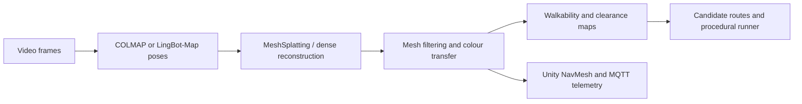
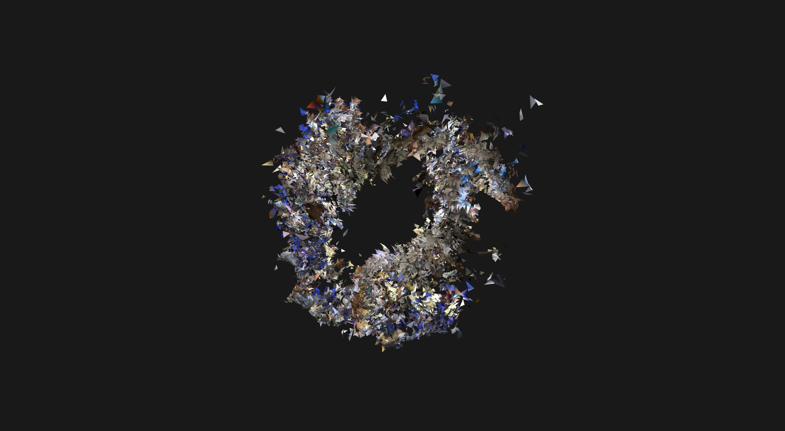
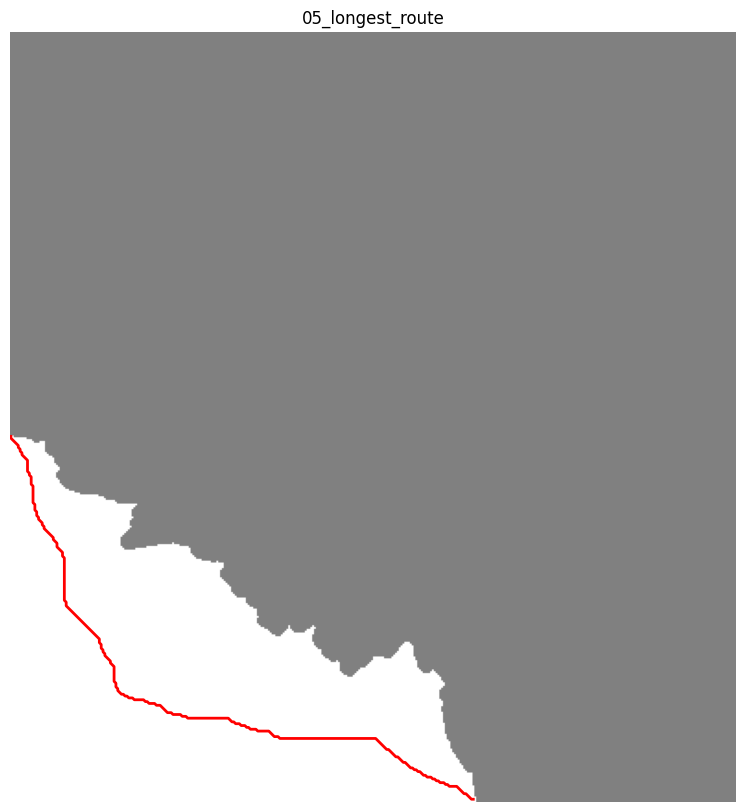
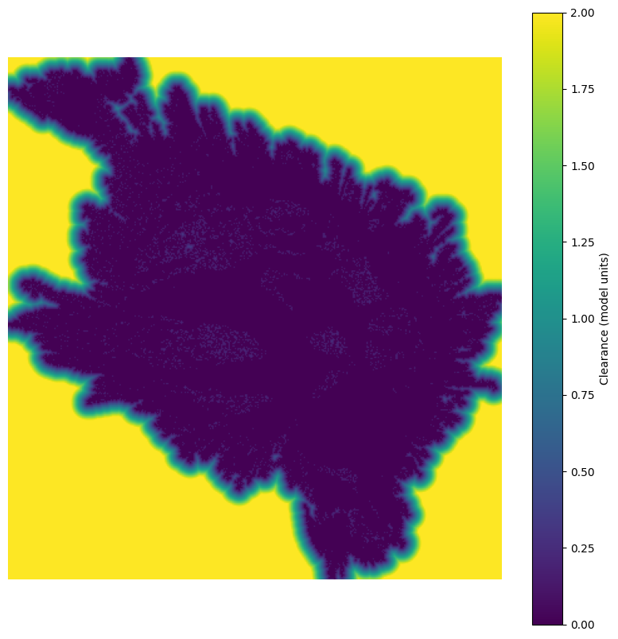
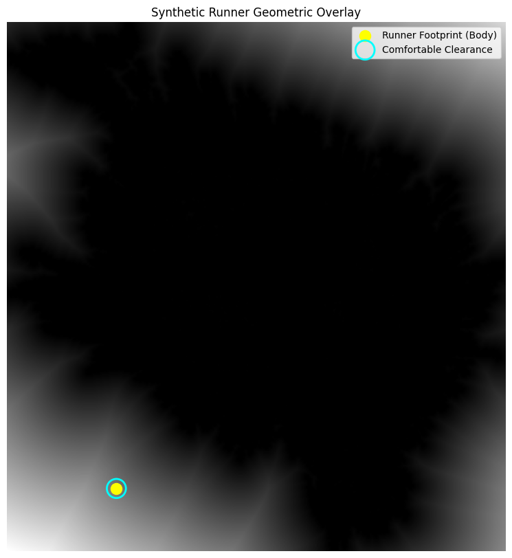

# Spatial Twin Reconstruction

**Video-based 3D reconstruction, traversability analysis and simulation**  
Summer internship project by **Lakshay Pal · 5G DoT Lab**

[](requirements.txt)
[](src/reconstruction)
[](src/unity_iot)

A research workflow for reconstructing a scene from video, preparing explicit mesh geometry, and analysing where an agent could move. It combines COLMAP/LingBot-Map camera estimation, adapted MeshSplatting sources, geometric post-processing, clearance-based route analysis and a procedural runner. Unity scripts add NavMesh crowd movement and simulated sensor telemetry over MQTT.

This repository records my internship implementation and integration work. COLMAP, LingBot-Map, MeshSplatting and their underlying methods remain the work of their respective authors; see [attribution and licences](NOTICE.md).

## Reconstruction to simulation



The reconstruction, analysis and game-engine stages are separate research scripts. They require scene data, external tools and workspace configuration; this is not a single-command application.

## Visual artifacts

<table>
<tr>
<td width="50%" valign="top"><a href="assets/lingbot_mesh.jpg"></a><br /><b>Reconstruction render</b><br />Saved MeshSplatting/LingBot scene output. Floating fragments and incomplete surfaces remain visible.</td>
<td width="50%" valign="top"><a href="assets/05_longest_route.png"></a><br /><b>Traversability and route extraction</b><br />A route on the rasterised walkable region, in uncalibrated model coordinates.</td>
</tr>
<tr>
<td width="50%" valign="top"><a href="assets/04_clearance_heatmap.png"></a><br /><b>Obstacle clearance</b><br />A distance-transform field used to test agent footprints.</td>
<td width="50%" valign="top"><a href="assets/synthetic_runner_test.png"></a><br /><b>Runner geometry check</b><br />Synthetic footprint and clearance overlay; the animation code is in <a href="src/spatial_analysis/runner_simulation.py">runner_simulation.py</a>.</td>
</tr>
</table>

[All maps and renders](assets/) · [Historical run records](docs/RESULTS.md) · [Publication checks](docs/PUBLICATION_NOTES.md)

## Work included

| Component | Implementation |
| --- | --- |
| Frame preparation and poses | Equirectangular-to-perspective reframing, matching utilities, COLMAP wrappers, LingBot-output conversion |
| Reconstruction | Dense fusion utilities, Alpha Shapes/Poisson/BPA experiments, filtering, ICP stitching and colour/texture transfer |
| MeshSplatting adaptation | Camera-model reader changes and Windows CUDA compatibility changes in supplied upstream-derived sources |
| Spatial analysis | Ground-orientation estimation, elevation/slope grids, distance-transform clearance, connected regions, skeleton graphs and bottleneck analysis |
| Simulation | Procedural Open3D runner; Unity NavMesh crowd scripts; Python MQTT sensor simulator and C# receiver |
| Inspection | Open3D utilities and local Three.js viewers for externally supplied mesh files |

The route code uses endpoint-selection and shortest-path heuristics on a skeleton graph. Its “longest route” filenames describe an experimental candidate, not a proven globally longest path. The runner is kinematic/procedural; there is no trained RL locomotion or navigation policy in this repository.

## Recorded experiments

The supplied July 2026 records describe an RTX 4050 laptop with 6 GB VRAM:

- A handheld-room reconstruction registered **86 of 88 frames**. A Splatfacto run reached step 29,710 before an out-of-memory failure; export used a checkpoint at step 28,000.
- MeshSplatting experiments used **4× downsampling** and a **2.5 million-point cap**. Separate COLMAP- and LingBot-initialised experiments are recorded in [RESULTS.md](docs/RESULTS.md).
- A stored route analysis reports **57.43 model units**. It cannot be interpreted as metres without independent scale calibration.

These are historical project records, not fresh benchmark reproductions. Raw videos, full reconstructed meshes, checkpoints and the complete Unity project are not bundled, so those measurements cannot be regenerated from the repository alone. Saved figures document examples rather than a quantitative navigation benchmark.

## Getting started

```sh
git clone https://github.com/Lakshaypal/Spatial-Twin-Reconstruction.git
cd Spatial-Twin-Reconstruction
python -m unittest discover -s tests -p 'test_pipeline_structure.py' -v
```

The command above checks the source archive's structure and Python syntax using the standard library. It does not invoke CUDA, COLMAP or Unity.

For geometry processing, create a Python 3.10/3.11 environment and review [requirements.txt](requirements.txt) and [environment.yml](environment.yml). Historical environments varied; choose a PyTorch/CUDA/compiler combination compatible with your machine rather than treating these files as a universally tested lockfile.

### Frame extraction

Install FFmpeg and the frame-processing dependencies. For **stitched equirectangular** footage:

```sh
python -m pip install py360convert opencv-python
python src/colmapping/reframe.py input-equirectangular.mp4 --out views --fps 1 --face 1200
```

For ordinary perspective video, extract frames directly with FFmpeg; do not apply the equirectangular transformation.

### Geometry and scale

The reconstruction and analysis scripts retain scene-specific workspace paths such as `C:\recon\ds02`. Configure the path constants, input meshes and camera assumptions for your scene before running them. The checked-in configuration example uses relative paths.

A measured reference distance can supply a scale factor:

```sh
python src/reconstruction/scale_from_pose.py --tape 2 --p1=0,0,0 --p2=1,0,0
```

This prints a factor; it does not apply the transform. Match the physical and reconstructed endpoints before using it on real data. Until then, lengths, areas, speeds and clearances remain in model units, including legacy plots or reports that use metre labels.

### MeshSplatting training

The supplied MeshSplatting folder is a **partial, adapted source snapshot**. In particular, `triangle_renderer`, `simple_knn` and `rdel` are not included. A compiled Linux extension from the supplied folder was omitted because it is machine-specific. Use the [complete upstream checkout and installation instructions](https://github.com/meshsplatting/mesh-splatting), preserve its required submodules/licences, and review the local camera-reader and rasterizer adaptations before integrating them. Installing the root requirements alone will not make the snapshot trainable.

The local exporter accepts a positional scene directory:

```sh
python src/mesh_splatting/create_ply.py outputs/scene --out mesh.ply --zup
```

### Unity and telemetry

Follow [the Unity setup guide](docs/UNITY_SETUP.md) with a separately created Unity project and your mesh. Put editor utilities (`AutoSetup.cs`, `FixScene.cs`) under `Assets/Editor`; put runtime scripts in `Assets/Scripts`. Install Pcx/appropriate mesh import support, AI Navigation, TextMeshPro and M2Mqtt as needed.

The recorded crowd experiment uses a proxy NavMesh plane; it is not validation that an agent can navigate the raw reconstructed surface. The MQTT receiver and simulated sensor publisher default to an unauthenticated broker on localhost. Keep that demo local or add authentication and TLS before remote use.

## Repository guide

- [`src/colmapping`](src/colmapping) — frame preparation, poses and format conversion
- [`src/mesh_splatting`](src/mesh_splatting) — upstream-derived training/export sources and local adaptations
- [`src/reconstruction`](src/reconstruction) — dense reconstruction, meshing and colour processing
- [`src/spatial_analysis`](src/spatial_analysis) — clearance, routes and runner simulation
- [`src/unity_iot`](src/unity_iot) — game-engine and sensor-simulation scripts
- [`src/visualization`](src/visualization) — mesh inspection and rendering tools
- [`docs`](docs) — historical workflow and experiment records
- [`references`](references) — original research links and citations

## Attribution and reuse

[NOTICE.md](NOTICE.md) distinguishes this internship archive from the upstream research implementations. The existing root MIT notice, including its named copyright holder, is retained. It does **not** replace the Apache and Gaussian-Splatting terms attached to upstream-derived components. Consult the component notices before reuse.
